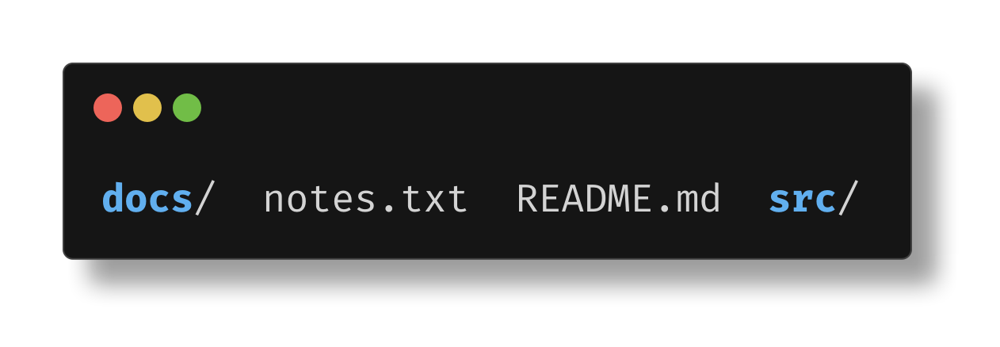
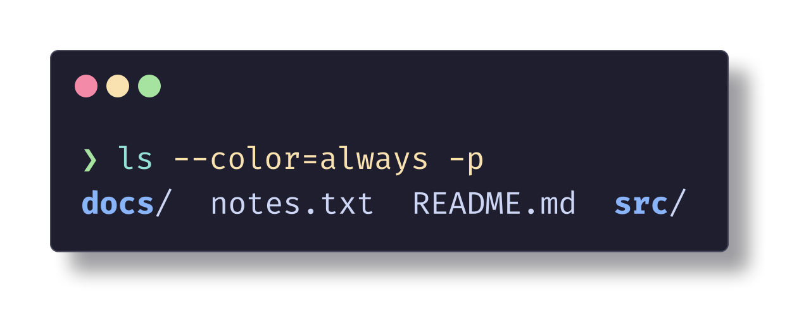
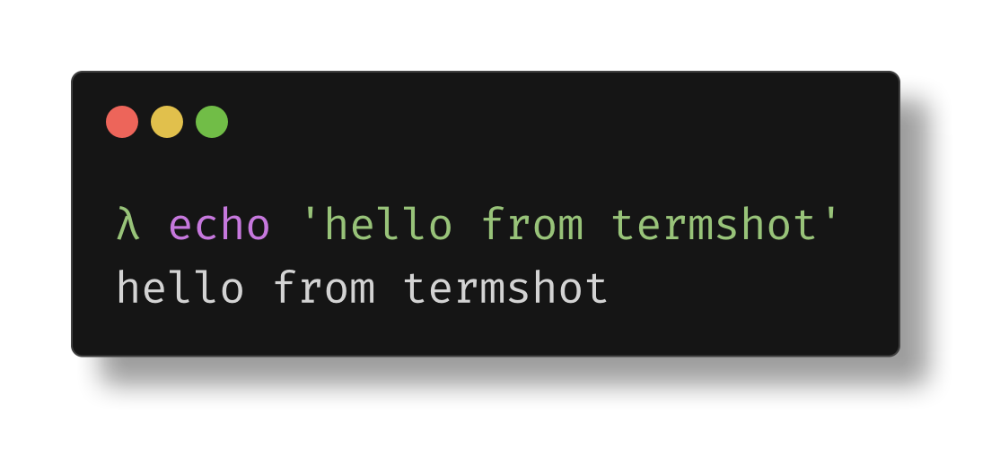
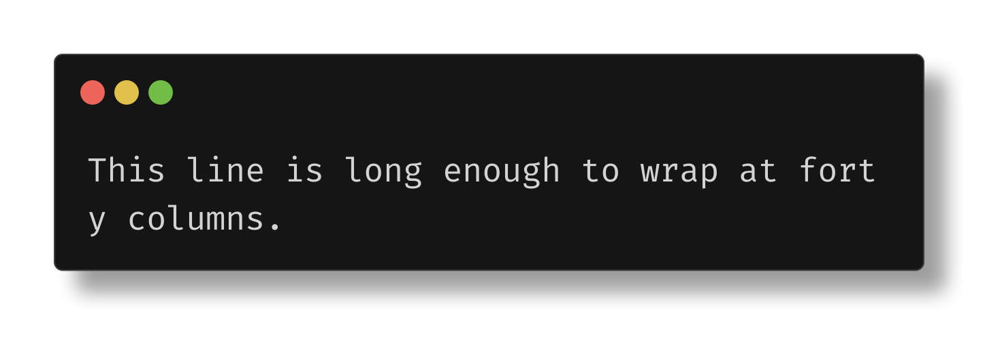
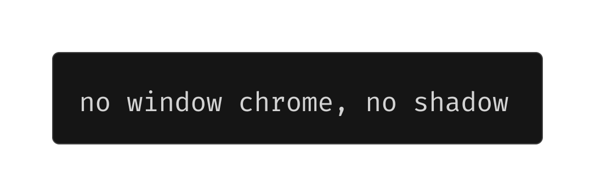
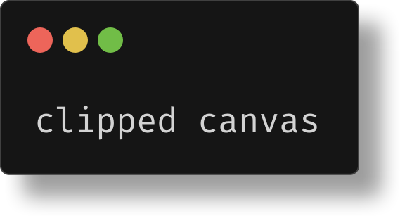
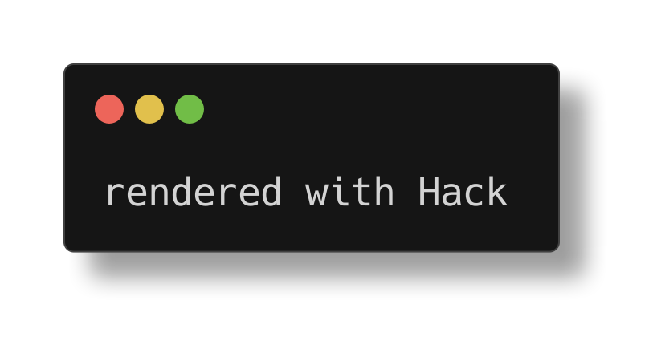
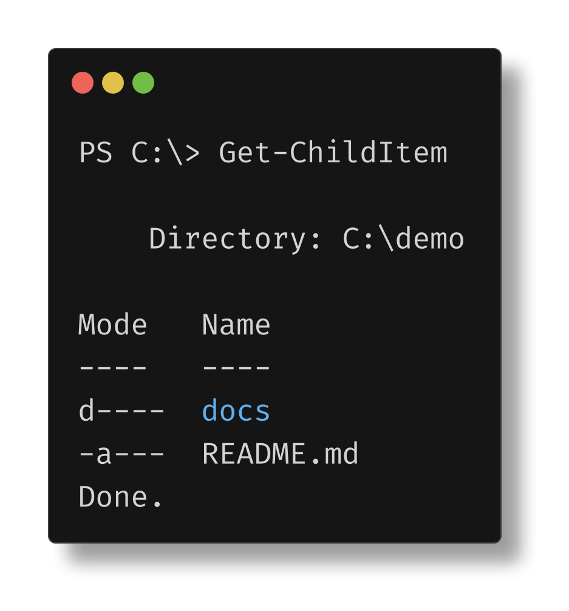

# Examples

Every flag goes before `--`, and everything after it is the command.

### Basic

```sh
termshot -- ls --color=always -p
```



### Show the command: `-c`

```sh
termshot -c -- "ls --color=always -p"
```


### Theme: `--theme`

`default`, `catppuccin-mocha`, `catppuccin-latte`, `nord`, `dracula`, `tokyo-night`, `gruvbox-dark`, `solarized-dark`. Use `--theme-file my-theme.json` for your own.

```sh
termshot -c --theme catppuccin-mocha -- "ls --color=always -p"
```



### Prompt: `--prompt`

```sh
termshot -c --prompt 'λ' -- "echo 'hello from termshot'"
```



### Columns: `-C`

Content wraps at 100 columns by default. Use `-C 0` for no limit.

```sh
termshot -C 40 -- echo "This line is long enough to wrap at forty columns."
```



### No window chrome: `--no-decoration --no-shadow`

```sh
termshot --no-decoration --no-shadow -- echo "no window chrome, no shadow"
```



### Clip canvas: `-s`

```sh
termshot -s -- echo "clipped canvas"
```



### Font: `--font`

`firacode-mono` (default), `hack`, `go-mono`. Use `--font-regular path.ttf` for your own font files.

```sh
termshot --font hack -- echo "rendered with Hack"
```



### Save raw output: `-w`

No screenshot is created. A bare `-w` names the file `<timestamp>-<random>.log`.

```sh
termshot -w -- /bin/zsh            # 20261016-124654-adfd683a.log
termshot -w session.log -- /bin/zsh
termshot -w - -- ls                # stdout
```

### Screenshot saved output: `-r`

Interactive redraws (tab completion, prompt rewrites, spinners) render as the final screen.

```sh
termshot -r session.log            # writes session.png
```



### Shell: `--shell`, `--shell-config`

```sh
termshot --shell /bin/zsh --shell-config ~/.zshrc -c -- "git status"
```

### Edit before rendering: `-e`

```sh
termshot -e -- ls -la
```

### Output file: `-f`

```sh
termshot -f shots/ls.png -- ls
```

### Defaults: `--set-default`

```sh
termshot --set-default theme=nord --set-default columns=80
termshot --unset-default columns
termshot --show-config
```
