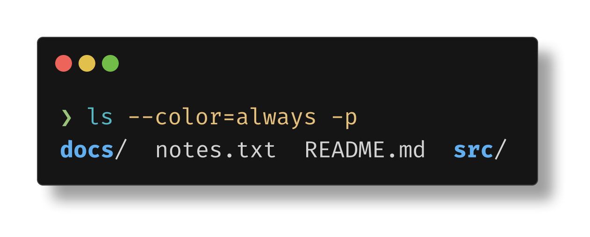

# termshot

A fork of [homeport/termshot](https://github.com/homeport/termshot) with more customisability (themes, fonts, prompts, config file defaults) and stable parsing of interactive terminal output.

Prefix any command with `termshot` and get a PNG of its output, rendered with the colours your terminal would show.

```sh
termshot -c -- "ls --color=always -p"
```



## What this fork adds

- **Stable parsing**: captured output runs through a real terminal emulator ([charmbracelet/x/vt](https://github.com/charmbracelet/x/tree/main/vt)), so tab completion, prompt redraws and spinners render as their final state, without crashes or garbage lines.
- **Themes and fonts**: 8 built-in themes, custom theme files, Fira Code by default, custom font files.
- **Config file**: generated on first run, so any flag can get a persistent default.
- **Syntax highlighting** of the command, custom prompt, shell selection.
- **Sensible defaults**: wraps at 100 columns, auto-named output files.

## Install

Grab the prebuilt Linux binary from [`bin/termshot`](bin/termshot), or build it yourself:

```sh
git clone https://github.com/sidd-sh/termshot && cd termshot
go build -o termshot ./cmd/termshot
```

## Usage

```sh
termshot [termshot flags] -- <command> [args]
```

Wrap commands with pipes or quotes in double quotes: `termshot -- "ls -1 | grep go"`.

| Flag | Purpose |
|---|---|
| `-c`, `--show-cmd` | Include the command in the screenshot |
| `-C`, `--columns` | Wrap after N columns (default `100`, `0` disables) |
| `--theme`, `--theme-file` | Built-in or custom JSON theme |
| `--font`, `--font-size`, `--font-regular` … | Font family, size, or font files |
| `--prompt`, `--no-syntax-highlight` | Prompt symbol, command highlighting |
| `--no-decoration`, `--no-shadow`, `-s` | Window chrome, shadow, clip canvas |
| `-f`, `--filename` | Output PNG (default: `termshot-<pid>.png`) |
| `-w`, `--raw-write` | Save raw output instead (default name: `<timestamp>-<random>.log`) |
| `-r`, `--raw-read` | Screenshot a saved raw output file |
| `--shell`, `--shell-config`, `--shell-opts` | Shell used to run the command |
| `-e`, `--edit` | Edit the output in `$EDITOR` first |

See [EXAMPLES.md](EXAMPLES.md) for every option with a screenshot.

## Config

On first run termshot writes all configurable flags with their defaults to `~/.config/termshot/config.json` (or `%AppData%\termshot\config.json` on Windows). Set `TERMSHOT_CONFIG` to use a different file. Flags given on the command line always win.

```sh
termshot --set-default theme=nord --set-default no-shadow=true
termshot --unset-default theme
termshot --show-config
```

## Credits

Based on [termshot](https://github.com/homeport/termshot) by the Homeport team, MIT licensed, see [LICENSE](LICENSE).
